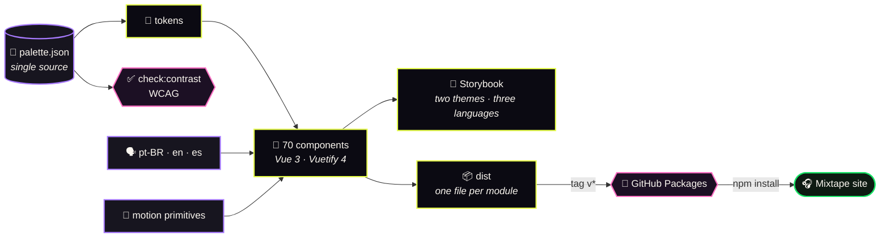

<div align="center">



<br>

**The design system of Mixtape, your music diary: 70 Vue 3 and Vuetify 4 components, neon design tokens<br>checked against WCAG, motion primitives and a Storybook in two themes and three languages.**

<br>


<br>

### 🎧 [Web](https://github.com/PedroLucasLopes/plataforma_mixtape-v1) · ⚙️ [API](https://github.com/PedroLucasLopes/mixtape-api-v1) · 🎨 UI library · 🔐 [Auth library](https://github.com/PedroLucasLopes/mixtape-oauth-lib-v1)

📓 [Decision log](CLAUDE.md) <sub>(Portuguese)</sub> · 📖 Storybook on port `6010`

</div>


<div align="center">

## ⚡ Start in one command

</div>

```bash
npm ci && npm run storybook
```

Open **http://localhost:6010**. Theme (dark or light) and language (pt-BR, en, es) are in Storybook's toolbar. 🎉

<br>

## 🗺️ From one palette to the app, in one diagram



<table>
<tr><td width="50%" valign="top">

**Two ideas hold it together**

1. **One source of truth for color.** `palette.json` feeds the theme and the contrast check, so the two can never disagree.
2. **The app pays only for what it renders.** One file per module, CSS per component, declared side effects and SVG icons for the names in use.

</td><td width="50%" valign="top">

**What that means in practice**

Every text, every component and the text on glass over each brand blob pass WCAG before a release can ship. A component the app does not use leaves the bundle together with its CSS, and one used on a single page lands in that page's chunk.

</td></tr>
</table>


<div align="center">

# 🚀 Getting started

</div>

## 📦 Installing

The package lives in **GitHub Packages**. In the app, a versioned `.npmrc`:

```ini
@pedrolucaslopes:registry=https://npm.pkg.github.com
//npm.pkg.github.com/:_authToken=${NODE_AUTH_TOKEN}
```

`NODE_AUTH_TOKEN` is a classic GitHub token with `read:packages`, taken from the environment (in Docker, as a BuildKit secret).

```bash
npm i @pedrolucaslopes/mixtape-ui vue vuetify vue-i18n @fontsource-variable/bricolage-grotesque @fontsource-variable/figtree
```

`vue` and `vuetify` are peer dependencies; `vue-i18n` is optional.

## 🔌 Wiring it into an app

**`plugins/vuetify.ts`**: the theme, the SVG icons and the language.

```ts
import { createMixtapeLocale, mixtapeIcons, vuetifyOptions } from '@pedrolucaslopes/mixtape-ui'
import { useI18n } from 'vue-i18n'
import { createVuetify } from 'vuetify'
import { APP_ICON_PATHS } from './icons.generated'
import { i18n } from './i18n'
import '@fontsource-variable/bricolage-grotesque/standard.css'
import '@fontsource-variable/figtree'
import 'vuetify/styles/core'
import '@pedrolucaslopes/mixtape-ui/styles'

export default createVuetify({
  ...vuetifyOptions,
  icons: mixtapeIcons(APP_ICON_PATHS),
  locale: createMixtapeLocale({ i18n, useI18n }),
})
```

**`main.ts`**: real links (`<a href>`) that navigate with vue-router.

```ts
import { MIXTAPE_LINK_KEY } from '@pedrolucaslopes/mixtape-ui'
import { RouterLink } from 'vue-router'

app.provide(MIXTAPE_LINK_KEY, RouterLink)
```

**`App.vue`**: the theme follows the system, and toasts get a host.

```vue
<script setup lang="ts">
  import { bindVuetifyTheme, MxToastHost } from '@pedrolucaslopes/mixtape-ui'

  bindVuetifyTheme()
</script>

<template>
  <VApp>
    <RouterView />
    <MxToastHost />
  </VApp>
</template>
```

> [!TIP]
> **Import only `vuetify/styles/core`.** The full `vuetify/styles` brings 235 KB of utilities and 40 KB of colors
> that no component uses. No `@mdi/font` either: `vuetifyOptions` registers SVG icons, and the app adds its own
> with `mixtapeIcons(...)`. `APP_ICON_PATHS` is the app's `name → path` map for the `mdi-*` icons it uses beyond
> the library's (the library's own subset ships in `@pedrolucaslopes/mixtape-ui/icons`).


<div align="center">

# 🎨 Using

</div>

## 🧩 Components

| | Group | Components |
|:--:|---|---|
| 🔘 | **Base** | `MxLink`, `MxButton`, `MxIconButton`, `MxGlass`, `MxChip`, `MxBrandIcon`, `MxFlag` |
| 🌀 | **Shapes** | `MxVinyl`, `MxBlobField`, `MxBlob`, `MxStarburst`, `MxMarquee` |
| 🖼️ | **Media** | `MxCover`, `MxCoverStack`, `MxAvatar`, `MxPersonCard`, `MxImageCredit`, `MxMosaic` |
| 💿 | **Ratings** | `MxRating`, `MxRatingInput`, `MxRatingHistogram` |
| 🏅 | **Gamification** | `MxStat`, `MxDiscTier`, `MxDiscProgress`, `MxBadge`, `MxPodium`, `MxRankRow`, `MxSplitBar`, `MxBarList` |
| 🎶 | **Music** | `MxItemCard`, `MxCrate`, `MxTrackList`, `MxReviewCard`, `MxGroupReviewCard`, `MxLikeButton`, `MxStreamingLinks`, `MxTimeAgo`, `MxDescriptionList` |
| 📐 | **Layout** | `MxAppShell`, `MxTopBar`, `MxTabBar`, `MxUserMenu`, `MxFooter`, `MxSection`, `MxRail`, `MxGrid`, `MxPagedGrid`, `MxRotator`, `MxPageHero`, `MxStoryCard`, `MxSegmented`, `MxSearchField`, `MxProgressBar` |
| 💬 | **Feedback** | `MxToastHost` and `toast`, `MxDialog`, `MxConfirmDialog`, `MxSkeleton`, `MxLoader`, `MxEmptyState`, `MxErrorState`, `MxLoadMore` |
| ✍️ | **Forms** | `MxTextField`, `MxTextarea`, `MxPasswordField`, `MxStepper`, `MxBalloonPicker` |
| 📣 | **Sharing and ads** | `MxShareSheet`, `MxQrCode`, `MxConsentBanner`, `MxAdFrame` |

A few that show how the pieces think:

- **`MxRatingInput`** is a real slider (arrows, Home/End, PageUp/PageDown) in **half discs** from 0 to 5, with a separate zero button, because zero is a valid rating.
- **`MxCrate`** is a stack of records you flip through by moving the mouse up and down, pull with a click, Enter or a tap, and browse as a `listbox` with the keyboard.
- **`MxCoverStack`** folds an album and its rated tracks into one cover with a counter, as a single button with `aria-expanded`.
- **`MxPasswordField`** shows the app's rules and a strength meter, and never suggests or generates a password: it is always the person's.

## 🎨 Tokens

| | Token | Value |
|:--:|---|---|
| ⬛ | Ink, the dark background | `#0B0A12` (not pure black, which smears on OLED and flattens elevation) |
| 🟩 | Lime, the call to action | `#E7FF4A` |
| 🩷 | Pink | `#FF6FC3` |
| 🟪 | Violet | `#7A2FF0` |
| 💚 | Green | `#19E266` |
| 🟧 | Orange | `#FF8A1F` |

- **Duotones** paint heroes and cards: a flat background plus a contrasting ink. An album's duotone comes from a hash of its MusicBrainz ID (`duotoneFor`), so every record always keeps its color.
- **Metals** (demo, bronze, silver, gold, platinum, diamond) dress the disc tiers and the badges: the gold record is literally golden.
- **The default theme is `system`.** In the light theme the Vuetify `primary` turns violet, since lime on white fails contrast; the call to action stays lime in both, with an ink outline in light mode.
- **Type:** Bricolage Grotesque for display (weight 800, condensed width) and Figtree for text, both OFL and self-hosted. Letter spacing comes from tokens (`--mx-tracking-display`, `-title`, `-numeral`), never from loose numbers.

## 🌊 Motion

| Primitive | What for |
|---|---|
| `v-reveal` | entrance on scroll (`up`, `down`, `left`, `right`, `scale`, `blur`, `pop`, `tilt`) with staggering, through one `IntersectionObserver` per page |
| `v-tilt` | 3D tilt with a glare that follows the pointer; off on touch and with reduced motion |
| `useCountUp` | numbers that count up when they appear; screen readers get the final value |
| `useInView`, `useScrollState` | animation triggers and bars that shrink on scroll |
| `startViewTransition` | page transitions with the View Transitions API, with a fallback |
| CSS springs | `--mx-spring-smooth`, `--mx-spring-bouncy`, `--mx-spring-pop`: `linear()` curves generated from a damped oscillator |

> [!NOTE]
> **Everything animates; nothing insists.** Every animation has a `prefers-reduced-motion` counterpart: the state
> stays, the movement goes. Entrance and looping animations touch only `transform` and `opacity`, blobs are radial
> gradients instead of blurred shapes, and `backdrop-filter` is reserved for what floats (bars, menus, dialogs).

## 🧪 Running the tests

```bash
npm test
```

<div align="center">

**290 tests** · unit in Node and components in jsdom · every component mounted on its own

</div>

| File | What it guarantees |
|---|---|
| `tests/components/contract.test.ts` | every component renders its own `data-testid`, passes a received id to exactly one element, and emits no Vue or Vuetify warning. A new component without a fixture fails here |
| `tests/components/*` | the behavior of the interactive ones by their ids: keyboard on the rating input, segmented control and stepper, the balloon picker's limit, the rotator's pause and reduced motion, the crate with mouse, keyboard and touch, the cover stack's `aria-expanded` |

```bash
npm run check:contrast   # the whole palette against WCAG, including text on glass over every brand blob
npm run check:locales    # pt-BR (reference), en and es, compiled with vue-i18n's own compiler
npm run check:testids    # data-testid on every root and interactive part
npm run check:icons      # every mdi-* in the code is in the shipped subset
npm run type-check
npm run build            # dist/: one file per module, CSS per component, type declarations
```

**Git hooks (Husky):** `pre-commit` runs only the checks the staged files need, `commit-msg` enforces Conventional Commits, and `pre-push` runs the tests.


<div align="center">

# 🏗️ Understanding

</div>

## 📂 How the code is organized

```
src/
│
├── 🎯 icons/          the SVG icon set and the generated MDI subset
├── 🎨 theme/          palette.json (single source), tokens, Vuetify options, the three-state theme
├── 🗣️ i18n/           pt-BR, en and es catalogs, useMixtapeText, createMixtapeLocale
├── 🌊 motion/         v-reveal, v-tilt, useCountUp, useInView, useScrollState, View Transitions
├── 🔢 format/         numbers, durations, MusicBrainz partial dates, initials, duotone by hash
├── 🔗 links/          MIXTAPE_LINK_KEY: the app injects its RouterLink
├── 🏅 gamification/   disc tiers and metals
├── 💬 feedback/       toasts and their host
├── 🎛️ styles/         base.css: keyframes, reveal and tilt utilities, glass, display type
├── 🧩 components/     Mx*.vue
├── 📖 stories/        stories by group, in both themes through the toolbar
└── 🎭 mocks/          made-up data for the stories; nothing here ships
```

## 📦 Publishing

```bash
npm version patch
git push --follow-tags
```

The `v*` tag triggers `.github/workflows/publish.yml`: it checks the tag against the version, audits the dependencies, checks contrast, translations and the Storybook build, and publishes with the run's own `GITHUB_TOKEN`. `prepublishOnly` runs translations, contrast, types and tests before compiling.

**Versioning:** a fix is a `patch`; a new prop, event, variant or export is a `minor`; changing or removing what exists is a `major`. **While the version starts with `0.`**, npm's `^` already treats a `minor` as incompatible, so breaking changes bump the `minor` and everything else bumps the `patch`.

| Ships in the package | Stays out |
|---|---|
| `dist/**/*.js` (ESM, one file per module, with source maps), each component's CSS, `dist/styles/base.css`, `.d.ts` declarations | stories, mocks, tests, `.storybook/`, `scripts/` |

## 🧭 Technical decisions

<details open>
<summary><b>Summary of the decisions</b></summary>

<br>

| Decision | Rejected alternative | Why |
|---|---|---|
| **A package installed through npm** | Importing the source by path or alias | The app builds on its own; versions say what changed |
| **One file per module (`preserveModules`) and CSS per component** | One bundle and one stylesheet | The app's bundler drops what is unused and splits the rest by page |
| **SVG icons, only the used ones** | The MDI icon font | The font was 403 KB of woff2 and 339 KB of CSS for about 40 icons |
| **Contrast checked by a script from the same palette** | Picking colors by eye | Theme and check can never drift apart |
| **Real `<a href>` links through an injected component** | Click handlers on divs | Open in a new tab, copy link and screen readers just work |
| **`data-testid` on every interactive part, verified at build time** | Selecting by class or translated text | Tests survive restyling and translation |

</details>


<div align="center">

<br>

**Type and icons:** [Bricolage Grotesque](https://fonts.google.com/specimen/Bricolage+Grotesque) and [Figtree](https://fonts.google.com/specimen/Figtree) (OFL, via Fontsource) · [Material Design Icons](https://pictogrammers.com/library/mdi/) (Apache 2.0) · [Simple Icons](https://simpleicons.org) (CC0) · built on [Vuetify](https://vuetifyjs.com) (MIT)

<br>

🎧 [Web](https://github.com/PedroLucasLopes/plataforma_mixtape-v1) · ⚙️ [API](https://github.com/PedroLucasLopes/mixtape-api-v1) · 🎨 UI library · 🔐 [Auth library](https://github.com/PedroLucasLopes/mixtape-oauth-lib-v1)

<sub>Proprietary, all rights reserved · Mixtape, your music diary</sub>

</div>
